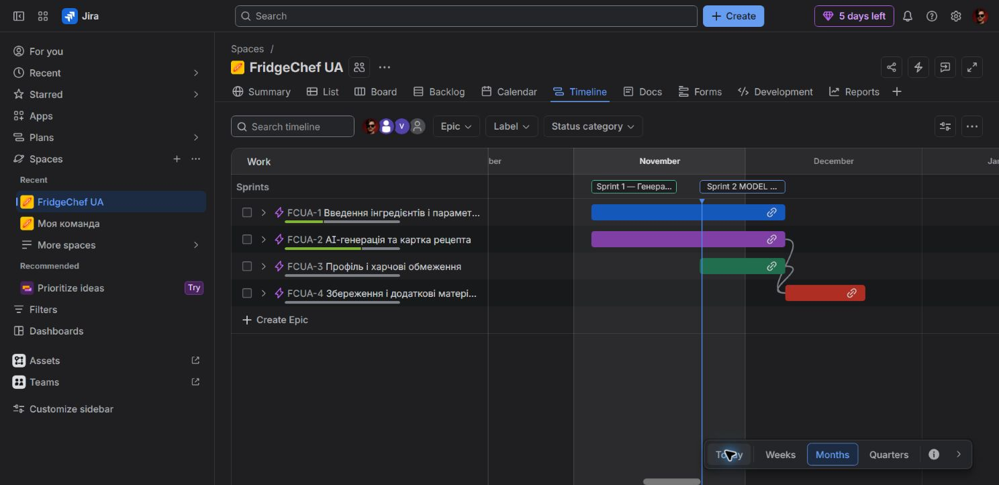
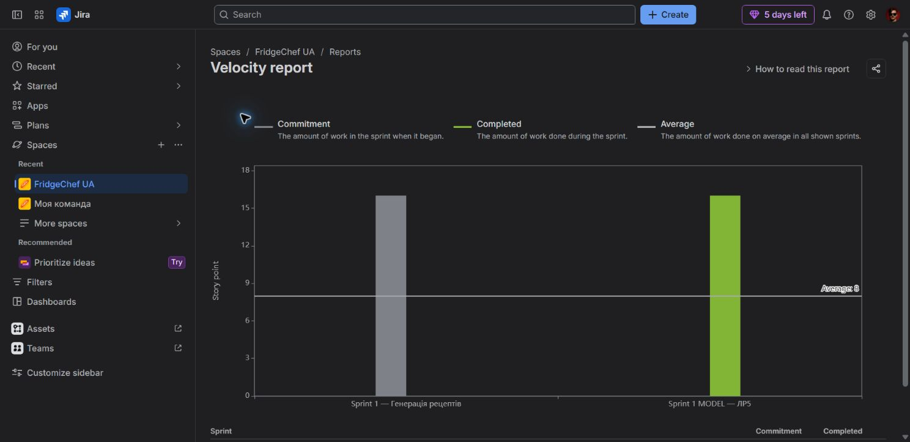
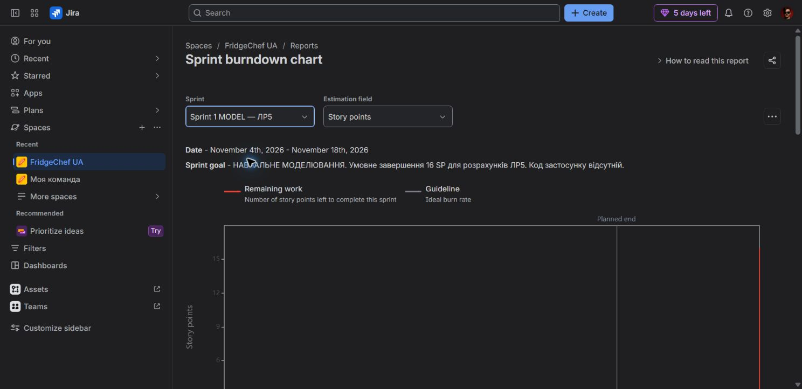
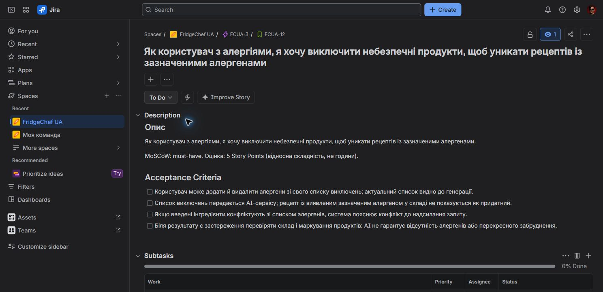
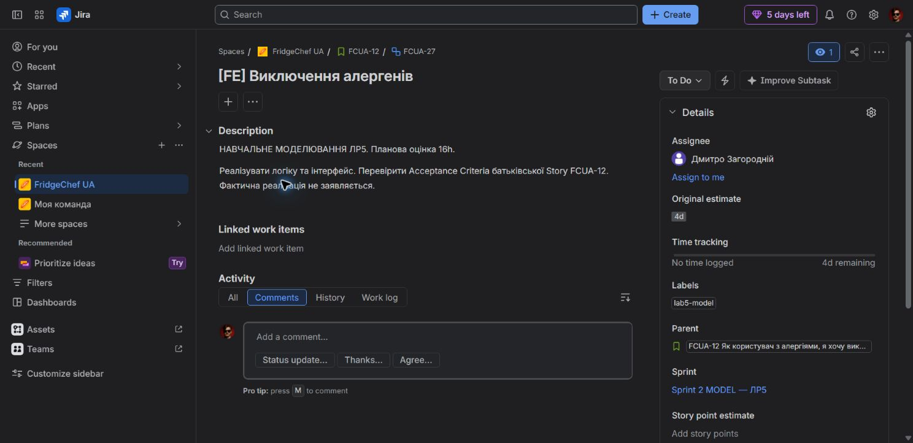
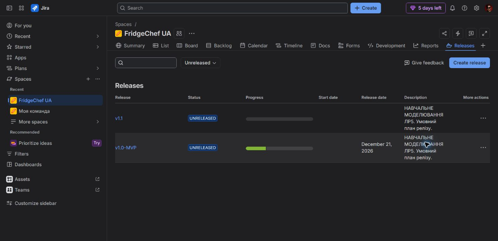

# План часу та вартості проєкту FridgeChef UA

**Лабораторна №5 · Команда:** Артур Кумановський, Сергій Пронь, Дмитро Загородній
**Дата:** 23.11.2026 · **[Jira](https://artyrcomfy3065.atlassian.net/jira/software/projects/FCUA/boards/34/backlog)** · **[Roadmap / Timeline](https://artyrcomfy3065.atlassian.net/jira/software/projects/FCUA/boards/34/timeline)**

> **Формат роботи — навчальне моделювання, погоджене власником проєкту. Код застосунку відсутній.**
> Done у MODEL-спринті та 96 годин у worklogs є умовними вхідними даними для відпрацювання інструментів планування. Це не підтвердження реалізації функцій, тестування продукту чи фактично відпрацьованого часу. У Jira відповідні записи позначені `lab5-model`, а worklogs містять пояснення моделі.
>
> Історичний Sprint 1 (ID 34) закрито зі збереженням результату **16 заплановано / 0 виконано**. Окремий Sprint 1 MODEL (ID 35) демонструє **16 умовно виконаних SP**. Прогноз нижче використовує модельні 16 SP, а не нульову фактичну продуктивність. Чи допускає викладач цей формат замість реальної розробки, потрібно уточнити під час здачі.

## 1. Вихідні дані з Jira

| Параметр | Значення | Джерело / пояснення |
|---|---:|---|
| Повний початковий беклог | 43 SP, 12 Stories, 4 Epics | FCUA-5…FCUA-16; без додавання SP епіків і підзадач |
| MVP, Must + Should | 38 SP, 10 Stories | Fix version v1.0-MVP |
| Could / Won't | 2 / 3 SP | FCUA-15 / FCUA-16 |
| Completed історичного Sprint 1, ID 34 | 0 SP | Velocity report |
| Completed Sprint 1 MODEL, ID 35 | 16 SP | FCUA-5: 3, FCUA-8: 8, FCUA-9: 5; модель |
| Середнє двох закритих спринтів | 8 SP | (0 + 16) / 2; не використовується як навчальна базова velocity |
| Базова velocity для сценарію | 16 SP/спринт | Окремий MODEL-сценарій, не виміряна стала швидкість команди |
| Команда | 3 особи | Реальні учасники FCUA |
| Робочий день / тиждень | 4 год / 5 днів | Global Time Tracking settings Jira |
| Ємність одного учасника | 40 год/спринт | 2 тижні × 5 днів × 4 год |
| Ємність команди | 120 год/спринт | 3 × 40 год |
| Ставка | $15/год | Умовна, задана методикою |
| Години MODEL-спринту | 96 год | FCUA-5: 18h, FCUA-8: 48h, FCUA-9: 30h |
| Sprint 2 | 17 SP / 102 год | 5 Stories, 15 Subtasks |
| Коефіцієнт годин/SP | 6 год/SP | 102 / 17; також 96 / 16 у заданому сценарії |

**Особливість звітів Jira.** MODEL-спринт створено 23.11 із демонстраційними датами 04–18.11. Stories додані 23.11, тому Velocity report чесно показує **Commitment 0 / Completed 16**, а Burndown відображає пізні зміни scope. Не можна видавати ці графіки за історію щоденної роботи протягом двох тижнів. Для навчального PV у розділі 7 окремо задано план 16 SP. Реальне значення Commitment MODEL-спринту дорівнює 0.

Параметри 4h/day і 5d/week збережені на рівні всього Jira-сайту. Оцінки завжди вводяться з одиницею `h`, щоб уникнути неоднозначного перерахунку днів.

### Sprint 2 MODEL — ЛР5

**ID:** 36; **стан:** Active; **період:** 23.11.2026 12:38–07.12.2026 12:38, Europe/Kyiv.
**Goal:** навчально спланувати параметри генерації, обробку помилок, тип харчування, алергени та збереження вподобань.

| Story | Зміст | SP | Design | FE | QA | Разом | Assignee Story |
|---|---|---:|---:|---:|---:|---:|---|
| FCUA-6 | Кухня, час, режим продуктів | 3 | 2h | 10h | 6h | 18h | Артур |
| FCUA-10 | Повідомлення про помилки AI | 3 | 2h | 10h | 6h | 18h | Дмитро |
| FCUA-11 | Тип харчування | 3 | 2h | 10h | 6h | 18h | Дмитро |
| FCUA-12 | Виключення алергенів | 5 | 4h | 16h | 10h | 30h | Дмитро |
| FCUA-13 | Збереження вподобань | 3 | 2h | 10h | 6h | 18h | Артур |
| **Разом** | | **17** | **12h** | **56h** | **34h** | **102h** | |

Підзадачі FCUA-17…FCUA-31 мають Original estimate і виконавців. Design виконує Артур; QA — Сергій; FE для FCUA-6 і FCUA-13 — Артур, для інших — Дмитро. Префікси позначають вид роботи, а не окремих додаткових людей. BE не додано, оскільки кожна Story вже має 3 підзадачі з дозволених ролей.

Розподіл ємності: Артур **32/40h**, Дмитро **36/40h**, Сергій **34/40h**. Резерв: **18h**, завантаження **85%**. Перевірка за SP: 17 / 16 = **106,25%**, перевищення **6,25%**, що вкладається у дозволені ±10%. Сума оцінок підзадач доступна через агреговане поле Jira; власна Original estimate батьківських Stories порожня, щоб не подвоювати години. В інтерфейсі поле батьківської власної оцінки може показувати Add estimate.

## 2. Критичний ланцюжок і залежності

Створені прямі Story-зв'язки `blocks`:

| Попередник | Блокує | Сенс |
|---|---|---|
| FCUA-5 | FCUA-7 | Спочатку визначити введення інгредієнтів, потім перевіряти параметри |
| FCUA-7 | FCUA-8 | Генерація використовує перевірений запит |
| FCUA-6 | FCUA-8 | Генерація враховує параметри |
| FCUA-8 | FCUA-9 | Картка відображає результат генерації |
| FCUA-9 | FCUA-14 | Збереження доступне для сформованого рецепта |
| FCUA-8 | FCUA-10 | Обробка помилок спирається на контракт інтеграції |
| FCUA-32 | FCUA-8 | Зовнішня доступність Gemini API |

FCUA-32 — окремий Task із міткою `external-dependency`. Його Done означає лише припущення доступності API в моделі, а не перевірений ключ або підключення сервісу. Перед розробкою потрібна реальна перевірка доступу й лімітів.

Залежності між Epics: **FCUA-2 blocks FCUA-4** і **FCUA-3 blocks FCUA-4**. Профіль є передумовою персонального збереження, AI-картка — передумовою збереження готового рецепта. Зв'язок FCUA-1 → FCUA-2 не використовується на рівні цілих епіків: їхні роботи можуть іти паралельно, а конкретна залежність визначена між Stories.

За правилом лабораторної «найбільша сума SP уздовж зв'язків» отримуємо:

| № | Issue | Story | SP | Блокує |
|---|---|---|---:|---|
| 1 | FCUA-5 | Введення інгредієнтів | 3 | FCUA-7 |
| 2 | FCUA-7 | Валідація параметрів | 2 | FCUA-8 |
| 3 | FCUA-8 | AI-генерація | 8 | FCUA-9 |
| 4 | FCUA-9 | Картка рецепта | 5 | FCUA-14 |
| 5 | FCUA-14 | Збереження рецепта | 3 | Умова готовності v1.0-MVP |
| | **Разом** | | **21 SP** | |

Це навчальний критичний ланцюжок за SP, а не доведений календарний critical path методом CPM: SP не є тривалістю, а для всього графа немає часових оцінок та ресурсного вирівнювання. Альтернативна гілка FCUA-6 → FCUA-8 → FCUA-9 → FCUA-14 має 19 SP.

| Epic / Story поза максимальним ланцюжком | Резерв / пояснення |
|---|---|
| FCUA-6 | Гілка на 2 SP коротша; це різниця ваг, а не 2 дні календарного Float |
| FCUA-10 | Окрема гілка після генерації; точний часовий Float не розрахований |
| FCUA-3 | Може виконуватися паралельно, але має завершитись до старту FCUA-4 |
| FCUA-15 | Could, відкладена версія v1.1 без обіцяного дедлайну |
| FCUA-16 | Won't, виключено з поточного релізу |

Статуси Done MODEL-спринту задані для вправи зі звітами. Вони **не доводять виконання залежностей**: зокрема FCUA-7 ще To Do. Перед реальним виконанням потрібно переоцінити статуси, перевірити попередники та спершу взяти незавершену валідацію. У Sprint 2 включена FCUA-6 — передумова критичної генерації; до реального Sprint Planning склад необхідно перепогодити з урахуванням FCUA-7.

### Дати Epic у Timeline

| Epic | Start | Due | Залежність |
|---|---|---|---|
| FCUA-1 | 04.11.2026 | 07.12.2026 | Конкретні Story-залежності |
| FCUA-2 | 04.11.2026 | 07.12.2026 | Передує FCUA-4 |
| FCUA-3 | 23.11.2026 | 07.12.2026 | Передує FCUA-4 |
| FCUA-4 | 08.12.2026 | 21.12.2026 | Після FCUA-2 та FCUA-3 |

У Timeline увімкнені залежності та прогрес. Епіки, що блокують FCUA-4, закінчуються раніше його початку. Прогрес 1/3 і 2/3 у перших двох епіках — прогрес умовних статусів, не готовності застосунку.

## 3. Прогноз тривалості

| Показник | Формула | Значення |
|---|---|---|
| Повний беклог | 43 / 16 | 2,6875 спринту |
| Округлення вгору | ceil(43 / 16) | 3 модельні спринти |
| MVP | 38 / 16 | 2,375 → 3 спринти |
| Залишок повного беклогу після MODEL | 43 − 16 | 27 SP |
| Залишок MVP | 38 − 16 | 22 SP |
| Спринтів після MODEL | ceil(27 / 16), ceil(22 / 16) | 2 в обох сценаріях |
| Sprint 2 | 23.11–07.12 | 17 SP |
| Наступний часовий слот | 07.12–21.12 | Залишок 10 SP повного беклогу / 5 SP MVP |
| Дата v1.0-MVP у Jira | Кінець двох наступних слотів | **21.12.2026** |
| Чи вкладаємося в семестр | Потрібна кінцева дата семестру | Не визначено: дату не надано |

Три спринти — розрахунок модельної потреби, а не твердження про три реально продуктивні спринти. Історичний Sprint 1 мав нульовий результат, а модельні 16 SP не дозволяють надійно прогнозувати реальну розробку. За фактичною velocity 0 дата релізу **не обчислюється**. Після першого справжнього спринту прогноз слід перерахувати.

Релізи створено як **Unreleased**, без публікації продукту:
- **v1.0-MVP**, дата 21.12.2026: FCUA-5…FCUA-14, усі Must/Should, 38 SP.
- **v1.1**, без дати: FCUA-15, Could, 2 SP.
- FCUA-16, Won't, 3 SP: Fix version порожня.

## 4. Вартість команди

| Показник | Формула | Значення |
|---|---|---:|
| Team Cost per Sprint | 3 × 40h × $15 | **$1 800,00** |
| Вартість 1 SP | $1 800 / 16 | **$112,50** |
| Вартість 1 години | Умовна ставка | **$15,00** |
| Годинний план Sprint 2 | 102h × $15 | $1 530,00 |
| Розподілена вартість 17 SP Sprint 2 | 17 × $112,50 | $1 912,50 |

$112,50/SP — розподіл повної ємності спринту на базові 16 SP. Це не тотожне 6h × $15 = $90/SP: останнє враховує лише оцінені години задач. Різниця покриває доступну ємність, зустрічі та резерв. Ці суми **не додаються між собою**. Для бюджету за методикою використано SP-модель; для навантаження — години підзадач. Через +6,25% до базової velocity SP-розподіл Sprint 2 перевищує номінальну вартість спринту.

## 5. Вартість по Epics

| Epic | Issue key | SP | Вартість = SP × $112,50 | Fix Version дочірніх Stories | Пріоритет |
|---|---|---:|---:|---|---|
| Введення інгредієнтів і параметрів | FCUA-1 | 8 | $900,00 | v1.0-MVP | Must / Should |
| AI-генерація та картка рецепта | FCUA-2 | 16 | $1 800,00 | v1.0-MVP | Must |
| Профіль і харчові обмеження | FCUA-3 | 11 | $1 237,50 | v1.0-MVP | Must / Should |
| Збереження і додаткові матеріали | FCUA-4 | 8 | $900,00 | MVP: 3 SP; v1.1: 2 SP; без версії: 3 SP | Should / Could / Won't |
| **Разом початковий беклог** | | **43** | **$4 837,50** | | |

MVP: 38 SP = **$4 275,00**. Could: 2 SP = $225,00. Won't: 3 SP = $337,50. Повний навчальний кошторис нижче включає 43 SP для порівнянності з початковим беклогом; бюджет саме MVP окремо наведений у розділі 6.

## 6. Бюджет проєкту

| Компонент | Розрахунок | Сума |
|---|---|---:|
| Оцінка повного беклогу | 43 × $112,50 | $4 837,50 |
| Contingency Reserve | 10% × $4 837,50 | $483,75 |
| **Working Budget** | $4 837,50 + $483,75 | **$5 321,25** |
| Management Reserve | 15% × $5 321,25 | $798,19 |
| **Total Budget** | $5 321,25 × 1,15 | **$6 119,44** |

Для MVP без Could/Won't: $4 275 × 1,10 × 1,15 = **$5 407,88**. Відсотки послідовні: сукупний множник 1,265, а не просте додавання 25%. Округлення — до центів у фінальному результаті.

Contingency покриває ідентифіковані ризики: нестабільність AI-відповідей, обробку помилок, додаткову перевірку параметрів. Management Reserve — невідомі зміни. Ставка та резерви навчальні; тариф Gemini, податки, хостинг і фактичні витрати не підтверджені й окремими реальними платежами не заявляються.

## 7. Earned Value за Sprint 1

### Навчальний сценарій

**Припущення PV:** план 16 SP взятий із початкового Sprint 1. **EV:** 16 умовно Done у MODEL. **AC:** 96 умовних годин у worklogs. Через відсутність справжньої розробки це демонстрація формул, а не оцінка ефективності людей.

| Метрика | Розрахунок | Значення | Джерело |
|---|---|---:|---|
| PV | 16 запланованих SP × $112,50 | $1 800,00 | План ID 34; припущення сценарію для MODEL |
| EV | 16 умовно завершених SP × $112,50 | $1 800,00 | Completed ID 35 |
| AC | 96 умовних годин × $15 | $1 440,00 | Worklogs FCUA-5/8/9 |
| **CV** | EV − AC | **+$360,00** | Формула |
| **SV** | EV − PV | **$0,00** | Формула |
| **CPI** | EV / AC | **1,25** | Умовна вартісна ефективність |
| **SPI** | EV / PV | **1,00** | Умовне виконання заданого плану |
| **EAC за шаблоном ЛР** | Total Budget / CPI = $6 119,4375 / 1,25 | **$4 895,55** | Демонстраційний прогноз |

| Індекс | Значення | Стан за шкалою ЛР | Інтерпретація лише в моделі |
|---|---:|---|---|
| CPI | 1,25 | 🟢 ≥ 1,0 | На $1 умовних витрат припадає $1,25 бюджетної цінності |
| SPI | 1,00 | 🟢 ≥ 1,0 | Умовно завершено весь заданий план |

Шкала: 🟢 ≥1,0; 🟡 від 0,9 до <1,0; 🔴 <0,9. Додатні CV та CPI не доводять реальну економію. За стандартним варіантом EAC = BAC/CPI, якщо BAC визначити без резервів як $4 837,50, результат становив би $3 870,00; тут основний рядок навмисно повторює формулу Total Budget/CPI із завдання.

### Що насправді показують первинні звіти

- **Історичний ID 34:** Commitment 16, Completed 0 → PV $1 800, EV $0, SPI **0**. Підтверджених фактичних трудовитрат немає; CPI та EAC за нульовими/невідомими AC визначати не можна.
- **MODEL ID 35 у Velocity:** Commitment **0**, Completed **16**. Якщо механічно взяти його Commitment як PV, PV = $0, а **SPI не визначений через ділення на нуль**. Тому значення SPI 1,00 вище стосується явно заданого плану сценарію, а не прихованої підміни даних Jira.
- Worklogs внесені адміністративно автором навчального сценарію. Автор запису не доводить, хто реально працював ці години; усі 96h умовні.
- MODEL закрито 23.11 після заданого кінця 18.11; його Burndown не підтверджує виконання у строк. SPI за обсягом при заданому PV та календарна своєчасність — різні твердження.

## 8. Скриншоти

| № | Що показано | Файл |
|---|---|---|
| 1 | Timeline: 4 Epics, прогрес і зв'язки | [roadmap.jpg](img/roadmap.jpg) |
| 2 | Velocity: історичні 0 SP і модельні 16 SP | [velocity.jpg](img/velocity.jpg) |
| 3 | Burndown Sprint 1 MODEL | [burndown-s1.jpg](img/burndown-s1.jpg) |
| 4 | Story FCUA-12 із підзадачами | [story-subtasks.jpg](img/story-subtasks.jpg) |
| 5 | Original estimate і Time Tracking підзадачі FCUA-27 | [subtask-time.jpg](img/subtask-time.jpg) |
| 6 | Версії v1.0-MVP та v1.1 | [releases.jpg](img/releases.jpg) |
| 7 | Налаштування 4h/day та 5d/week | [time-settings.jpg](img/time-settings.jpg) |

## 9. Рефлексія

**Наскільки години збігаються зі Story Points?** У сценарії 102h / 17 SP = 6h/SP. Співвідношення однакове для всіх п'яти Stories, тому це свідомо спрощене планове припущення. Його не отримано емпірично. Реальні SP описують відносну складність і ризик; після виконання співвідношення зміниться.

**Як змінилося розуміння термінів? Чи встигаємо до кінця семестру?** Гіпотеза 16 SP дає 3 модельні спринти на 43 SP; після умовного базового завершення потрібно ще 2 слоти до 21.12.2026. За реальною velocity 0 прогноз відсутній. Кінцеву дату семестру не надано, тому стверджувати, що вкладаємося, не можна.

**Що показали CPI/SPI та що змінити у Sprint 2?** Навчальні CPI 1,25 та SPI 1,00 демонструють формули; первинний спринт мав SPI 0. Треба спочатку погодити визначення Done, вести справжні worklogs, брати перевірені передумови та фіксувати scope до старту спринту. Sprint 2 сплановано на 17 SP/102h із резервом 18h, але реальну швидкість ще слід виміряти.

**Яка залежність найнебезпечніша?** Gemini API → генерація FCUA-8: зовнішні ліміти, доступ і формат відповіді впливають на центральний сценарій та картку рецепта. Потрібні перевірка контракту, тайм-аути, обробка помилок і контроль результату. Для алергенів AI-відповідь не є гарантією безпеки.

**Звідки AC?** 96h внесені як умовні worklogs: 18 + 48 + 30. Це не оцінка реально відпрацьованих годин. Правило «кількість членів × фактичні години × $15» застосовувати нема до чого, бо фактичні години не надані.

### Короткий текст для захисту

«У цій роботі я перетворив беклог FridgeChef UA на навчальну модель часу та вартості. Застосунок ще не реалізований, тому я розділив реальну історію й умовний сценарій. Початковий спринт має нуль завершених SP, а MODEL-спринт — 16 умовних SP.

Я створив зв'язки blocks, виділив ланцюжок на 21 SP та додав зовнішню залежність від Gemini. Для п'яти Stories другого спринту створено 15 підзадач на 102 години, з виконавцями. План становить 17 SP — на 6,25% більше модельної бази.

На Timeline епіки мають дати, прогрес і залежності. Для MVP встановлено дату 21 грудня, версію v1.1 залишено без дати. Це прогноз за припущенням 16 SP, а не обіцянка реального релізу.

За умовною ставкою 15 доларів година команда коштує 1800 доларів за спринт. Бюджет початкових 43 SP із резервами становить 6119,44 долара; саме MVP — 5407,88. У заданому сценарії CPI дорівнює 1,25, SPI — 1,00. Але Commitment MODEL у Jira дорівнює нулю через пізнє внесення Stories, тому без окремого припущення про план SPI був би невизначений. Це обмеження я прямо зафіксував у звіті».
