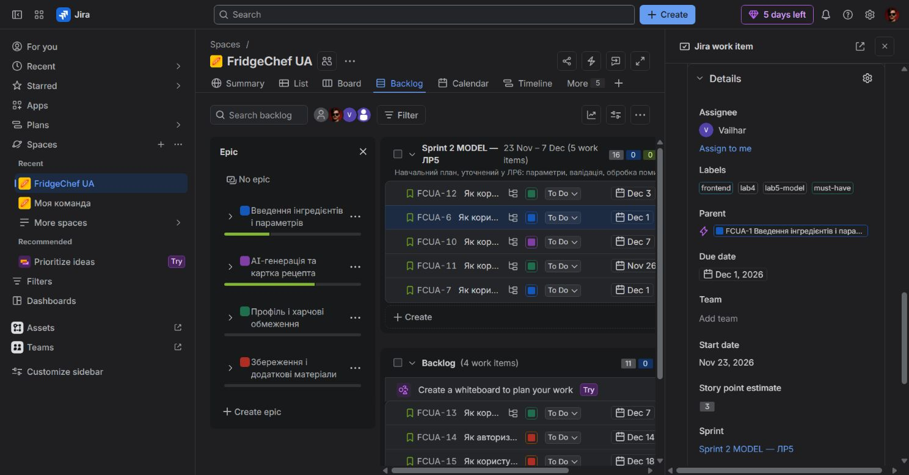
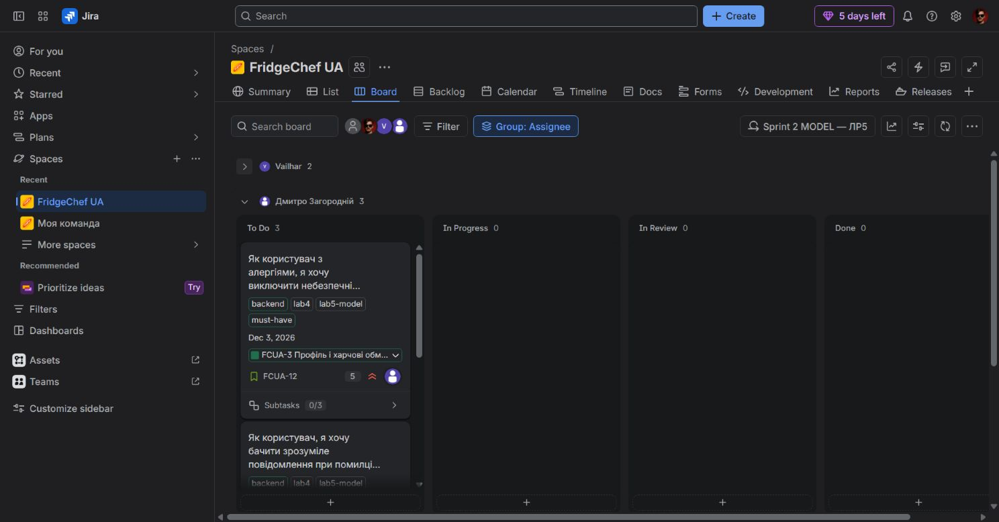
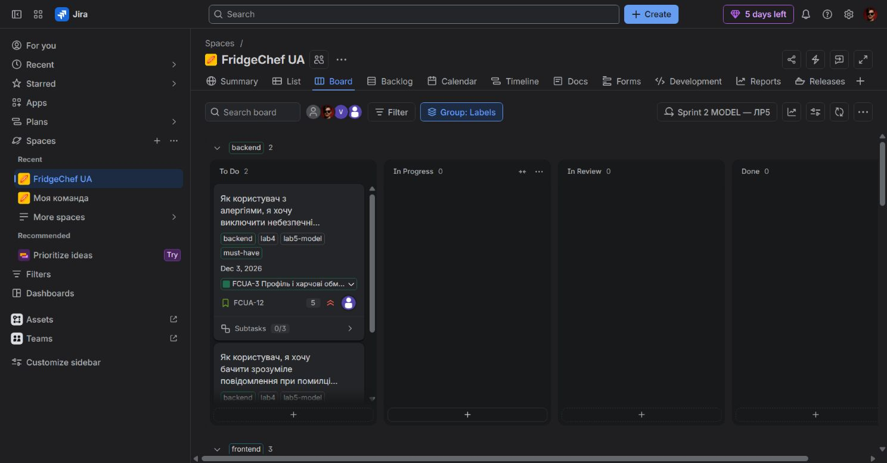
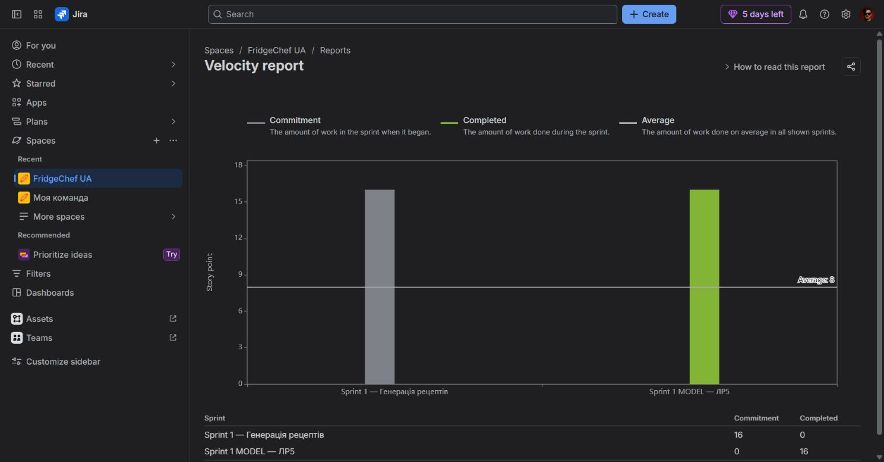
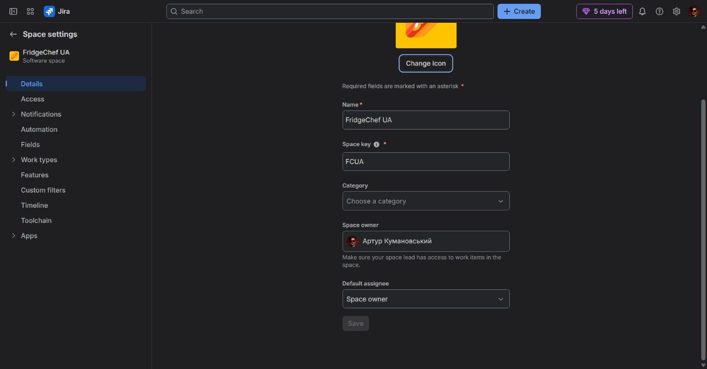
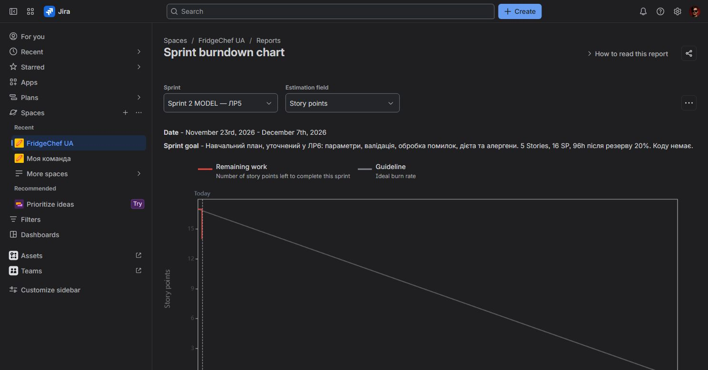

# Лабораторна №6 — Управління ресурсами FridgeChef UA

**Дата перевірки:** 23.11.2026. **Проєкт:** FCUA, board 34, приватний Team-managed.
**[Backlog](https://artyrcomfy3065.atlassian.net/jira/software/projects/FCUA/boards/34/backlog)** · **[Board](https://artyrcomfy3065.atlassian.net/jira/software/projects/FCUA/boards/34)** · **[Дані перевірки](docs/resources-data.json)**

> Години доступності — погоджене з власником **планове припущення 20 год/тиждень на людину**, оскільки підтверджених графіків немає. Це узгоджується з 4h/day × 5d/week з ЛР5. Навички нижче передав власник команди; це самооцінка, не результати тестування.
>
> Застосунок ще не реалізований. Історичний Sprint 1 має 0 виконаних SP. Окремий Sprint 1 MODEL має 16 умовних SP і 96 умовних годин; ці дані не видаються за фактичну продуктивність чи витрачений час. ЛР6 використовує поточні задачі й призначення з Jira та явно зазначені припущення доступності.

## 2.1. Склад команди

FTE рахується від стандартних **40 годин на тиждень**: 20 / 40 = 0,5. У Jira 4-годинний день використовується для відображення оцінок, а не для зміни знаменника FTE.

| Учасник | Ролі в проєкті та зони | Доступність, FTE | Годин на тиждень | Роль Jira |
|---|---|---:|---:|---|
| Артур Кумановський | PM/PO, QA Lead; координатор infra | 0,5 | 20 | Administrator, Space owner |
| Сергій Пронь — Vailhar | Frontend Lead, Design Lead; Analyst | 0,5 | 20 | Member |
| Дмитро Загородній | Backend/API Lead; Frontend Developer | 0,5 | 20 | Member |
| **Разом** | **3 члени команди** | **1,5** | **60** | |

Space settings → Access підтверджує ці ролі. Окремо в доступі вже присутній Andrii Hlazunov; він не входить до команди розробки й не враховується в Capacity. У ЛР6 запрошення та права доступу не змінювались.

**Default assignee:** Space owner — Артур Кумановський. Нові задачі потрапляють PM на первинний розподіл; це не замінює вибору зони та призначення Area Lead.

## 2.2. Capacity на спринт

| Параметр | Значення | Коментар |
|---|---:|---|
| Тривалість | 2 тижні | Поточний Sprint 2 MODEL, ID 36 |
| Період | 23.11.2026 12:38–07.12.2026 12:38 | Europe/Kyiv, з Jira |
| Сума годин команди | 3 × 20 × 2 = **120 год** | Планова доступність |
| Непродуктивний час | 20% = **24 год** | Мітинги, рев'ю, координація |
| **Ефективна Capacity** | 120 × 0,8 = **96 год** | По 32 год на людину |
| Velocity фактичного Sprint 1, ID 34 | **0 SP** | Velocity report, реальної розробки не було |
| Velocity окремого MODEL, ID 35 | **16 SP, умовно** | Не фактична швидкість команди |
| Годин на SP за фактичною velocity | **Не визначено** | 96 / 0 не обчислюється |
| Навчальне співвідношення | 96 / 16 = **6 год/SP** | Лише модель |
| Початковий план поточного Sprint 2 | **17 SP / 102 год** | Знімок ЛР5 |
| **Поточний план після вирівнювання** | **16 SP / 96 год** | 5 Stories, 15 підзадач |

План 16 SP можливий **за навчального припущення**, але ще не підтверджений реальною velocity. 96 годин задач займають 100% ефективної ємності; окремого резерву на непередбачену розробку понад 20% немає. За перших ознак відхилень scope слід зменшити, не скорочуючи QA.

Середнє двох закритих спринтів Jira — (0 + 16) / 2 = 8 SP, але воно змішує реальний нуль і модельні дані та не використовується як доведена продуктивність.

## 2.3. Skills Matrix

Шкала: **0 — немає, 1 — базовий, 2 — впевнений, 3 — сильний**. Значення перенесені без змін із повідомлення користувача.

| Навичка | Артур | Сергій | Дмитро | Потрібний рівень | Кількість на потрібному рівні / ризик |
|---|---:|---:|---:|---:|---|
| Frontend | 1 | 3 | 3 | ≥2 | 2; є взаємозаміна |
| Backend/API | 2 | 0 | 2 | ≥2 | 2; Артур — резерв Дмитра |
| Бази даних | 2 | 1 | 2 | ≥2 | 2; є взаємозаміна |
| Тестування | 3 | 1 | 0 | ≥1 | 2; складне QA залежить від Артура |
| DevOps / деплой | 0 | 0 | 0 | ≥1 | **0; компетенція не покрита** |
| Дизайн / Figma | 1 | 3 | 1 | ≥1 | 3 базово; сильний дизайн лише у Сергія |
| Git / Code Review | 1 | 1 | 1 | ≥2 | **0; необхідне навчання всім** |

Назви Frontend і Backend/API не засвідчують знання конкретних React/Node.js: користувач оцінив загальні напрями, тому технологічні навички не приписуються.

## 2.4. Аналіз Skills Matrix

Bus Factor тут — кількість людей, що досягають потрібного рівня для конкретної компетенції. Це спрощений індикатор покриття; число без врахування документації та взаємозаміни не доводить стійкість проєкту.

| Питання | Відповідь |
|---|---|
| Яка навичка покрита лише однією людиною? | Сильне тестування рівня ≥2 — Артур; сильний дизайн рівня ≥2 — Сергій |
| Bus Factor у критичних зонах | Frontend 2, Backend/API 2, БД 2; базове QA 2, поглиблене QA 1; DevOps 0; Git/Review на рівні ≥2 — 0 |
| Яка потрібна навичка відсутня або слабка? | DevOps повністю відсутній, Git у всіх лише 1. Дмитро має 0 у тестуванні, Сергій — 0 у Backend/API |
| Як підвищити Bus Factor? | QA-чеклісти й передача тестових сценаріїв Сергію; специфікації макетів і парне проєктування з Артуром; спільна практика Git і деплою |

**План закриття прогалин — заплановані заходи, не заявлені як виконані:**

| Дія | Хто | Термін / критерій перевірки |
|---|---|---|
| Передати QA-чекліст і 3 типові негативні сценарії | Артур → Сергій; Дмитро долучається | До кінця Sprint 2, 07.12; учасник самостійно пояснює й виконує перевірки |
| Відтворити простий макет і стани помилок | Сергій → Артур | До кінця Sprint 3, 21.12; Артур самостійно відтворює макет |
| Відпрацювати branch, commit, pull request, review, конфлікт і revert | Усі; координує Артур | Sprint 3; по одному навчальному PR і розв'язаному конфлікту на учасника |
| Освоїти простий деплой тестового прикладу та відкат | Артур + Дмитро; Сергій перевіряє інструкцію | Sprint 3; повторюваний deploy/rollback за README |
| Повторно оцінити Git/DevOps | Усі | Після практичної перевірки, до планування Sprint 4 |

У команді немає підтвердженого внутрішнього експерта з DevOps або Git рівня 2. Для цих напрямів потрібні навчальні матеріали та, за потреби, консультація викладача; PM організовує навчання, але не оголошується експертом.

## 2.5. Зони відповідальності — Labels

Правило: кожен запис має **рівно одну зону** з `frontend, backend, design, qa, infra`. Службові `lab4`, `lab5-model`, `lab6-resources`, `must-have` тощо не є зонами та залишаються.

| Label | Area Lead | К-сть усіх записів | Без Epics | У поточному спринті | Що входить |
|---|---|---:|---:|---:|---|
| frontend | Сергій | 16 | 14 | 8 | UI, форми, клієнтська валідація, картка та добірка |
| backend | Дмитро | 6 | 4 | 2 | Контракт API, AI-інтеграція, дані й логіка обмежень |
| design | Сергій | 6 | 6 | 5 | Макети, UX, стани помилок |
| qa | Артур | 6 | 6 | 5 | Перевірка AC, негативні й граничні сценарії |
| infra | Артур, координатор | 1 | 1 | 0 | Доступність зовнішнього API, надалі деплой та оточення |
| **Разом** | | **35** | **31** | **20** | |

Числа «усі записи» відповідають фільтру `project = FCUA AND labels = frontend` (аналогічно для інших зон). У 35 записах є 4 Epics, 12 Stories, 18 Subtasks і 1 Task. Для вимоги Stories/Tasks/Subtasks окремо наведена колонка без Epics. Додатково розмічено самі Epics.

**Призначення:** Area Lead бере задачі за замовчуванням. Frontend-задачі FCUA-7, FCUA-21, FCUA-27, FCUA-30 і FCUA-34 делеговані Дмитру: його Frontend = 3. Історичний FCUA-5 залишений Артуру для збереження обліку MODEL; нові складні frontend-роботи йому не призначено. Відповідальний за infra — організатор перевірки, а не доказ DevOps-компетенції.

Універсальна Story може містити кілька технічних робіт. Її єдина зона означає основну відповідальність, а зони підзадач визначають фактичний розподіл дизайну, frontend і QA. Це не суперечність: батьківська Story та її підзадачі — різні записи.

**Контроль Jira:**
- `project = FCUA AND labels is EMPTY` → **0**.
- `project = FCUA AND assignee is EMPTY` → **0** за повною вибіркою.
- Перевірка перетину Labels із п'ятьма зонами → **рівно 1 у всіх 35**.
- Усі 15 підзадач поточного спринту мають Original estimate та Assignee.

## 2.6. Аналіз Workload з Jira

Поточний Sprint 2 — **ID 36**, після зміни scope у ЛР6: Stories **FCUA-6, FCUA-7, FCUA-10, FCUA-11, FCUA-12**. Усі ще To Do. SP рахуються лише на Stories, години — на підзадачах; не додаємо батьківські агрегати вдруге.

| Учасник | Записів у поточному спринті | Stories / Subtasks | SP поточного scope | SP done поточного | Виконання | Години задач / ефективна Capacity | Висновок |
|---|---:|---|---:|---:|---:|---|---|
| Артур | 5 | 0 / 5 | 0 | 0 | — | 32 / 32 | QA; 0 SP не означає відсутність роботи |
| Сергій | 9 | 2 / 7 | 6 | 0 | 0% | 32 / 32 | 20h Frontend + 12h Design |
| Дмитро | 6 | 3 / 3 | 10 | 0 | 0% | 32 / 32 | Frontend підзадачі, ownership Backend Stories |
| **Разом** | **20** | **5 / 15** | **16** | **0** | **0%** | **96 / 96** | Баланс годин 1:1:1 |

**Committed і поточний scope не ототожнюються.** На старті ID 36 було 17 SP: Артур 6, Дмитро 11, Сергій 0 за тодішніми Assignee. У ЛР6 FCUA-13 (3 SP) перенесено в Backlog, FCUA-7 (2 SP) додано; відповідальних змінено. Тепер scope 16 SP, розподіл 0/6/10. Історичне commitment не переписувалось. Відсоток виконання в таблиці стосується поточного scope, не порівняння різних спринтів.

### Попередній завершений спринт і Time Spent

| Учасник | SP done історичного Sprint 1, ID 34 | SP done окремого MODEL, ID 35 | Time Spent за автором worklog у MODEL |
|---|---:|---:|---:|
| Артур | 0 | 3 | 96h умовних записів |
| Сергій | 0 | 5 | 0h записів |
| Дмитро | 0 | 8 | 0h записів |
| **Разом** | **0** | **16 умовних** | **96h умовних** |

Власники MODEL Stories: Артур FCUA-5 (18h), Дмитро FCUA-8 (48h), Сергій FCUA-9 (30h). Але автор **всіх трьох worklogs — Артур**, тому при групуванні саме за автором записи дають 96/0/0, а не 18/48/30. Жоден варіант не означає реально відпрацьовані години. У поточному Sprint 2 Time Spent — 0 у всіх.

Velocity report: ID 34 **Commitment 16 / Completed 0**; ID 35 **Commitment 0 / Completed 16** через пізнє створення MODEL. Burndown збережено окремо. Реальні показники виконання людей із цієї моделі не виводяться.

## 2.7. Вирівнювання навантаження

| Виявлена проблема | Виконане рішення | Результат |
|---|---|---|
| План 102h перевищував ефективні 96h | FCUA-13: 18h / 3 SP повернуто в Backlog разом із підзадачами; натомість FCUA-7: 12h / 2 SP включено у Sprint 2 | 102 − 18 + 12 = **96h**, 17 − 3 + 2 = **16 SP**, збережено 5 Stories |
| QA було у Сергія з рівнем 1, Артур має 3 | Підзадачі QA передано Артуру | 5 активних QA-підзадач, **32h** |
| Дизайн був у Артура з рівнем 1, Сергій має 3 | Підзадачі Design передано Сергію | 5 активних Design-підзадач, **12h** |
| Frontend був у Артура з рівнем 1 | 52h активного FE розподілено між Сергієм (20h) і Дмитром (32h), обидва рівень 3 | Разом із Design/QA у кожного **32h** |
| Незавершена валідація була поза спринтом | FCUA-7 додано та декомпозовано на FCUA-33/34/35: Design 2h, FE 6h, QA 4h | Пріоритет передумови генерації |
| Були записи без Assignee, не було зон | Призначено виконавців, рівно одну зону кожному, Default assignee → Space owner | 0 непризначених і 0 без Labels |

Початкові години по виконавцях: Артур 32h, Сергій 34h, Дмитро 36h. Після зміни scope та розподілу ролей: **32/32/32h**. Відхилення від середнього — **0%**; межа ±10% виконана. Оцінки наявних підзадач не занижувалися, нових фіктивних годин виконання не додано.

FCUA-13 залишається в MVP; перенесення у Backlog не означає виключення з релізу. ЛР5 збережена як історичний план, а зміна описана окремим повідомленням на початку її звіту.

## 2.8. Ресурсний план по спринтах

Це план доступності, не твердження про створені чи запущені майбутні спринти. Дати наступних слотів — прогноз; графік сесії/свят не надано.

| Спринт / слот | Період, Kyiv | Потрібні зони | Capacity | Запланований обсяг / особливості |
|---|---|---|---:|---|
| Поточний Sprint 2, ID 36 | 23.11–07.12.2026 | Frontend, Backend, Design, QA | **96h** | 16 SP, 96h, 5 Stories; уже в Jira |
| Sprint N+1, план Sprint 3 | 07.12–21.12.2026 | Backend, Frontend, QA, Design; навчання infra/Git | **96h** | FCUA-13 + FCUA-14 = 6 SP; орієнтир 36h за модельними 6h/SP. Додатково 24h навчання Git/DevOps (по 8h), до 36h резерву на уточнення та перевірки |
| Sprint N+2, план Sprint 4 | 21.12.2026–04.01.2027 | Frontend, QA, infra | **до 96h** | FCUA-15: 2 SP лише після MVP і підтвердження доступності; орієнтир 12h, ще 12h закріплення навичок. Святковий/екзаменаційний графік потрібно уточнити |

Для Sprint 3 арифметична межа при 24h навчання: floor((96 − 24) / 6) = **12 SP**, але наявний залишок MVP становить лише **6 SP**. Заповнювати спринт до межі заради кількості не потрібно. 18h для FCUA-13 вже є у підзадачах; додаткові 18h для FCUA-14 — **попередній орієнтир**, не записана в Jira оцінка. Її треба декомпозувати й оцінити перед стартом.

FCUA-15 належить v1.1 без дати, тому грудневий слот є можливістю, а не новим обіцяним дедлайном. FCUA-16 (Won't) не заплановано. Відсутність DevOps/Git-компетенції може зсунути реальний реліз; дата MVP з ЛР5 залишається модельною.

Якщо фактична доступність виявиться 15h/тиждень замість 20h, ефективна Capacity зменшиться до 3 × 15 × 2 × 0,8 = **72h**. План 96h потрібно буде скоротити на 24h; додаткові години автоматично не припускаються.

## 2.9. Скриншоти з Jira

| № | Що показано | Файл |
|---|---|---|
| 1 | Backlog із відкритою панеллю FCUA-6 та видимими Labels | [lab6-labels.jpg](docs/img/lab6-labels.jpg) |
| 2 | Board → Group: Assignee | [lab6-workload.jpg](docs/img/lab6-workload.jpg) |
| 3 | Board → Group: Labels | [lab6-areas.jpg](docs/img/lab6-areas.jpg) |
| 4 | Velocity report | [lab6-velocity.jpg](docs/img/lab6-velocity.jpg) |
| 5 | Details → Space owner / Default assignee | [lab6-default-assignee.jpg](docs/img/lab6-default-assignee.jpg) |
| 6 | Access: ролі членів команди | [lab6-access.jpg](docs/img/lab6-access.jpg) |
| 7 | Burndown поточного Sprint 2 зі зміною scope | [lab6-burndown.jpg](docs/img/lab6-burndown.jpg) |

У поточному Backlog немає перемикача Labels серед полів рядка, тому мітки показані в панелі картки без виходу з Backlog. Board за замовчуванням показує Stories: Артур має QA-підзадачі, тому його відсутність серед груп батьківських Stories не означає нульового навантаження. У Group: Labels службові мітки створюють додаткові групи — одну задачу не можна підраховувати повторно за всіма такими групами.

## 2.10. Висновки команди

**Хто перевантажений або недовантажений?** До корекції план перевищував ефективну ємність на 6h, Сергій мав 34h, Дмитро 36h проти 32h. Після зміни scope та призначень усі мають по 32h. За годинами баланс рівний, за кількістю записів і SP — різний; це нормально, бо QA та дизайн оцінені годинами у підзадачах.

**Який Bus Factor і як його підвищуємо?** Frontend, Backend/API й БД мають по двох впевнених виконавців. Поглиблене QA та сильний дизайн залежать від однієї людини. DevOps і Git на потрібному рівні мають покриття 0. Потрібні документування, передача QA/дизайну та перевірена практика Git/деплою; до її проходження рівні не підвищуються.

**Чи реалістичні SP за поточної Capacity?** 16 SP і 96h узгоджені арифметично з моделлю 6h/SP та плановими 20h/тиждень. За реальної velocity 0 це ще не доказ досяжності. Потрібні підтвердження доступності та перший фактичний спринт. План повністю використовує ефективну ємність, тому за відхилень scope потрібно зменшувати.

**Яка зона має найбільше задач?** Frontend: 16 записів із Epics або 14 без них; два сильні виконавці. В активному спринті FE займає 52h, поділені 20/32 між Сергієм і Дмитром. Дизайн додає Сергію 12h, QA займає в Артура 32h. Тому великий frontend-обсяг забезпечений двома людьми.

### Короткий текст для захисту

«У шостій лабораторній я визначив п'ять зон відповідальності через Labels і призначив Area Leads. У всіх 35 записах Jira є рівно одна мітка зони та виконавець. Default assignee — власник простору, тобто PM.

Доступність я взяв як планове припущення: по 20 годин на тиждень. За два тижні це 120 годин команди, після 20% на зустрічі й рев'ю — 96 годин. Початковий план був 102 години. Я переніс збереження вподобань у Backlog і додав важливішу валідацію, тому залишилося п'ять Stories на 16 SP і 96 годин.

Skills Matrix заповнена за наданими оцінками. Артур найсильніший у QA, Сергій — у дизайні й frontend, Дмитро — у frontend і Backend/API. Тому QA передано Артуру, дизайн Сергію, frontend поділено між Сергієм і Дмитром. Кожен отримав по 32 години задач.

Головні ризики — DevOps 0 у всіх і Git 1 у всіх. Я не приховував ці прогалини: додав план навчання й перевірки навичок. Нуль SP у Артура в поточному спринті не означає відсутність роботи, бо його 32 години знаходяться в QA-підзадачах. Модельні результати минулої лабораторної окремо відділені від фактичних».

## Додаток. Реєстр задач на момент перевірки

Години нижче — **власна Original estimate запису**, без дублювання батьківських агрегатів. «Поза активним» включає Backlog та окрему завершену зовнішню залежність.

| Key | Тип | Зона | Assignee | SP | Original estimate, h | Розміщення |
|---|---|---|---|---:|---:|---|
| [FCUA-1](https://artyrcomfy3065.atlassian.net/browse/FCUA-1) | Epic | frontend | Vailhar | — | — | Поза активним |
| [FCUA-2](https://artyrcomfy3065.atlassian.net/browse/FCUA-2) | Epic | backend | Дмитро Загородній | — | — | Поза активним |
| [FCUA-3](https://artyrcomfy3065.atlassian.net/browse/FCUA-3) | Epic | backend | Дмитро Загородній | — | — | Поза активним |
| [FCUA-4](https://artyrcomfy3065.atlassian.net/browse/FCUA-4) | Epic | frontend | Vailhar | — | — | Поза активним |
| [FCUA-5](https://artyrcomfy3065.atlassian.net/browse/FCUA-5) | Story | frontend | Артур Кумановський | 3 | 18 | MODEL 1 |
| [FCUA-6](https://artyrcomfy3065.atlassian.net/browse/FCUA-6) | Story | frontend | Vailhar | 3 | — | Sprint 2 |
| [FCUA-7](https://artyrcomfy3065.atlassian.net/browse/FCUA-7) | Story | frontend | Дмитро Загородній | 2 | — | Sprint 2 |
| [FCUA-8](https://artyrcomfy3065.atlassian.net/browse/FCUA-8) | Story | backend | Дмитро Загородній | 8 | 48 | MODEL 1 |
| [FCUA-9](https://artyrcomfy3065.atlassian.net/browse/FCUA-9) | Story | frontend | Vailhar | 5 | 30 | MODEL 1 |
| [FCUA-10](https://artyrcomfy3065.atlassian.net/browse/FCUA-10) | Story | backend | Дмитро Загородній | 3 | — | Sprint 2 |
| [FCUA-11](https://artyrcomfy3065.atlassian.net/browse/FCUA-11) | Story | frontend | Vailhar | 3 | — | Sprint 2 |
| [FCUA-12](https://artyrcomfy3065.atlassian.net/browse/FCUA-12) | Story | backend | Дмитро Загородній | 5 | — | Sprint 2 |
| [FCUA-13](https://artyrcomfy3065.atlassian.net/browse/FCUA-13) | Story | backend | Дмитро Загородній | 3 | — | Поза активним |
| [FCUA-14](https://artyrcomfy3065.atlassian.net/browse/FCUA-14) | Story | frontend | Vailhar | 3 | — | Поза активним |
| [FCUA-15](https://artyrcomfy3065.atlassian.net/browse/FCUA-15) | Story | frontend | Vailhar | 2 | — | Поза активним |
| [FCUA-16](https://artyrcomfy3065.atlassian.net/browse/FCUA-16) | Story | frontend | Vailhar | 3 | — | Поза активним |
| [FCUA-17](https://artyrcomfy3065.atlassian.net/browse/FCUA-17) | Subtask | design | Vailhar | — | 2 | Sprint 2 |
| [FCUA-18](https://artyrcomfy3065.atlassian.net/browse/FCUA-18) | Subtask | frontend | Vailhar | — | 10 | Sprint 2 |
| [FCUA-19](https://artyrcomfy3065.atlassian.net/browse/FCUA-19) | Subtask | qa | Артур Кумановський | — | 6 | Sprint 2 |
| [FCUA-20](https://artyrcomfy3065.atlassian.net/browse/FCUA-20) | Subtask | design | Vailhar | — | 2 | Sprint 2 |
| [FCUA-21](https://artyrcomfy3065.atlassian.net/browse/FCUA-21) | Subtask | frontend | Дмитро Загородній | — | 10 | Sprint 2 |
| [FCUA-22](https://artyrcomfy3065.atlassian.net/browse/FCUA-22) | Subtask | qa | Артур Кумановський | — | 6 | Sprint 2 |
| [FCUA-23](https://artyrcomfy3065.atlassian.net/browse/FCUA-23) | Subtask | design | Vailhar | — | 2 | Sprint 2 |
| [FCUA-24](https://artyrcomfy3065.atlassian.net/browse/FCUA-24) | Subtask | frontend | Vailhar | — | 10 | Sprint 2 |
| [FCUA-25](https://artyrcomfy3065.atlassian.net/browse/FCUA-25) | Subtask | qa | Артур Кумановський | — | 6 | Sprint 2 |
| [FCUA-26](https://artyrcomfy3065.atlassian.net/browse/FCUA-26) | Subtask | design | Vailhar | — | 4 | Sprint 2 |
| [FCUA-27](https://artyrcomfy3065.atlassian.net/browse/FCUA-27) | Subtask | frontend | Дмитро Загородній | — | 16 | Sprint 2 |
| [FCUA-28](https://artyrcomfy3065.atlassian.net/browse/FCUA-28) | Subtask | qa | Артур Кумановський | — | 10 | Sprint 2 |
| [FCUA-29](https://artyrcomfy3065.atlassian.net/browse/FCUA-29) | Subtask | design | Vailhar | — | 2 | Поза активним |
| [FCUA-30](https://artyrcomfy3065.atlassian.net/browse/FCUA-30) | Subtask | frontend | Дмитро Загородній | — | 10 | Поза активним |
| [FCUA-31](https://artyrcomfy3065.atlassian.net/browse/FCUA-31) | Subtask | qa | Артур Кумановський | — | 6 | Поза активним |
| [FCUA-32](https://artyrcomfy3065.atlassian.net/browse/FCUA-32) | Task | infra | Артур Кумановський | — | — | Поза активним |
| [FCUA-33](https://artyrcomfy3065.atlassian.net/browse/FCUA-33) | Subtask | design | Vailhar | — | 2 | Sprint 2 |
| [FCUA-34](https://artyrcomfy3065.atlassian.net/browse/FCUA-34) | Subtask | frontend | Дмитро Загородній | — | 6 | Sprint 2 |
| [FCUA-35](https://artyrcomfy3065.atlassian.net/browse/FCUA-35) | Subtask | qa | Артур Кумановський | — | 4 | Sprint 2 |
